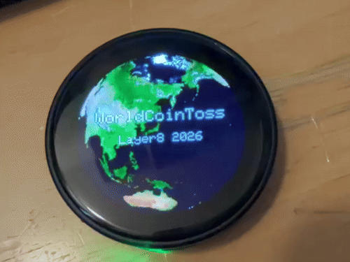

# CoinM5 — World Coin Toss

**世界中で利用できる意思決定支援機。**

高度なアルゴリズムにより、どのような二択問題にも適当な回答を提示します。

**注意：重要な事項の最終的な判断（裏にするか表にするか）は、ご自身でお願いします。**

A decision-support device for use anywhere in the world.

Using a sophisticated algorithm, CoinM5 provides an appropriately random answer to any either-or question.

**Warning: The final decision on important matters (whether to choose heads or tails) is entirely up to you.**

[日本語](#日本語) | [English](#english)

## 日本語

CoinM5 は M5Stack StopWatch の円形ディスプレイで楽しむ、世界の歴史貨幣を使ったコイントスアプリです。

- 世界各地の歴史貨176枚、352面を収録（R4 FINAL176 FIX5 実機確認版）。
- 1933年ダブルイーグル金貨、天正大判、シベリア10コペイカ銅貨、ザンジバル1パイサ銅貨、ヤップ島の石貨、サムドラグプタ王の琴演奏図金貨、アクスム王国エンドゥビス王の金貨などを収録。
- 地球儀を探索し、地域や硬貨の密集度に合わせて3段階で接近。
- 日本語・英語に対応。全176枚に個別の硬貨情報と「うらおもて」の歴史エピソードを収録。

### R4 — 世界の至宝

2026年11月29日（JST）、最終構成 R4 FINAL176 FIX5 の動作をM5Stack StopWatchで開発者が確認しました。1933年ダブルイーグルの画像は博物館所蔵個体であり、2021年に18,872,250米ドルで落札された個体とは異なります。

硬貨画像は240×240。APPと硬貨DATAを分離し、専用DATA領域13,565,952バイトのうち13,480,996バイト（99.37%）を使用します。

最終版では148番・150番を上記2枚の金貨に差し替え、全176枚に個別の日英解説を収録しました。歴史解説は読み物としての記載であり、学術的な鑑定・評価を保証するものではありません。

### 操作方法

| 画面 | 操作 |
| --- | --- |
| 地球儀 | スワイプで回転、タップで地域に接近 |
| 接近画面 | スワイプで移動、地図をタップしてさらに接近。硬貨をタップして選択 |
| 接近画面 | 左ボタンで一段階前の表示に戻る |
| 密集した硬貨 | 枚数付きのグループをタップし、スワイプで硬貨を選択 |
| 地球儀 | 右ボタンでランダムに硬貨を選択 |
| 地球儀 | 左ボタンで素材の出典・著作権情報 |
| 硬貨 | 振る、右ボタン、またはタップでコイントス |
| 硬貨 | 左ボタンで戻る、左ボタンのダブルクリックで硬貨情報 |
| 硬貨情報 | 右ボタンで硬貨情報や画像出典を切り替え、左ボタンで戻る |
| 硬貨情報・出典 | タップで日本語・英語を切り替え |

### インストール

対象機種：**M5Stack StopWatch**

**[Web BurnerでCoinM5をインストール（176枚版）](https://burner.m5stack.com/UJWSH9)**

[M5Burner公式案内](https://docs.m5stack.com/ja/uiflow/m5burner/intro)。

APPと画像DATAは別々に更新します。画像DATAが最終176枚版であれば、文章・機能の通常更新はAPPのみで、DATAの再書き込みは不要です。専用DATA領域がない場合の初回導入は通常更新と区別し、既存のFlash構成・保存データへの影響を確認してから行ってください。

## English

CoinM5 is a coin-toss app for the circular display of the M5Stack StopWatch, featuring historical coins from around the world.

- 176 historical coins with 352 faces in the hardware-tested R4 FINAL176 FIX5 edition.
- Includes the 1933 Double Eagle, Tensho oban, Siberian 10 kopecks, Zanzibar 1 pysa, Yap stone money, Samudragupta's lyrist gold dinar, and the Aksumite gold coin of Endubis.
- Explore the globe with three zoom levels that adapt to local coin density.
- Japanese and English interfaces, with individual coin information and bilingual Heads or Tails historical stories for all 176 coins.

### R4 — Treasures of the World

On November 29, 2026 (JST), the developer confirmed operation of R4 FINAL176 FIX5 on M5Stack StopWatch hardware. The pictured 1933 Double Eagle is a museum specimen, not the individual coin auctioned for US$18,872,250 in 2021.

Coin images are 240×240. Application and coin data are separate; the dedicated coin data region uses 13,480,996 of 13,565,952 bytes (99.37%).

The final edition replaces slots 148 and 150 with the two gold coins above and provides individual bilingual stories for every coin. The stories are introductory historical notes, not professional numismatic appraisals.

### Controls

| Screen | Action |
| --- | --- |
| Globe | Swipe to rotate; tap to zoom into a region |
| Zoomed view | Swipe to move; tap the map to zoom further or tap a coin to select it |
| Zoomed view | Press the left button to return to the previous zoom level |
| Coin clusters | Tap a numbered cluster and swipe to choose a coin |
| Globe | Press the right button to select a random coin |
| Globe | Press the left button to view credits |
| Coin | Shake, press the right button, or tap to toss |
| Coin | Press the left button to return; double-click it for coin information |
| Coin information | Right button cycles through coin information and image sources; left returns |
| Information / credits | Tap to switch between Japanese and English |

### Installation

Supported device: **M5Stack StopWatch**

**[Install CoinM5 via Web Burner (176-coin edition)](https://burner.m5stack.com/UJWSH9)**

[Official M5Burner guide](https://docs.m5stack.com/en/uiflow/m5burner/intro).

Application and image-data updates are separate. Once the final 176-coin data is installed, ordinary text and application updates do not require rewriting the image data. Initial provisioning of the dedicated data region is a separate operation; check its impact on the existing flash layout and stored data before proceeding.

## Image credits / 画像出典

全176枚の画像出典を、収録時期に応じた3つの一覧に掲載しています。

The following three attribution lists cover all 176 coins in the final collection.

**硬貨画像の著作権・個別出典： [COIN_IMAGE_CREDITS.md](COIN_IMAGE_CREDITS.md)**

R1の歴史貨100枚、[R2で追加した28枚](R2_COIN_IMAGE_CREDITS.md)、[R3/R4最終追加48枚](R3_R4_COIN_IMAGE_CREDITS.md)について、所蔵館・撮影者、個別の資料URL、ライセンスおよび加工内容を掲載しています。原写真の権利は各所蔵館・撮影者に由来し、加工済み画像にも該当するライセンスを適用します。

**Coin image copyright and attribution: [COIN_IMAGE_CREDITS.md](COIN_IMAGE_CREDITS.md)**

The R1 attribution list, [R2 additional coin credits](R2_COIN_IMAGE_CREDITS.md), and [R3/R4 final additional 48 coin credits](R3_R4_COIN_IMAGE_CREDITS.md) identify sources and applicable licenses for all 176 historical coins (352 faces), including individual collection records and modifications. Original photographs and adapted image data retain their applicable licenses.

- Day: [NASA Earth Observatory — Blue Marble Next Generation, July 2004](https://science.nasa.gov/earth/earth-observatory/blue-marble-next-generation/base-map/).
- Night: [NASA Earth Observatory — Black Marble 2016](https://science.nasa.gov/earth/earth-observatory/earth-at-night/maps/).
- Original 100-coin collection: 99 CC0 coins from Cleveland Museum of Art, The Metropolitan Museum of Art, and the Walters Art Museum, plus the Kaiyuan Tongbao below.
- R2 additions: [28 historical coins — individual image credits and licenses](R2_COIN_IMAGE_CREDITS.md).
- R3/R4 final additions: [48 historical coins — individual image credits and licenses](R3_R4_COIN_IMAGE_CREDITS.md).
- Kaiyuan Tongbao: [image by CZDK](https://commons.wikimedia.org/wiki/File:Kai_Yuan_Tong_Bao,_early_type,_plain.jpg), [CC BY-SA 3.0](https://creativecommons.org/licenses/by-sa/3.0/). Adaptations include splitting the two faces, cropping, background removal, masking, resizing, and RGB565 palette quantization. The adapted image data retains CC BY-SA 3.0.
- Individual coin image sources are available in the app. Modern coin images are not included in this edition.

NASA and the museums do not endorse CoinM5.

## Author

Layer8 · 2026
